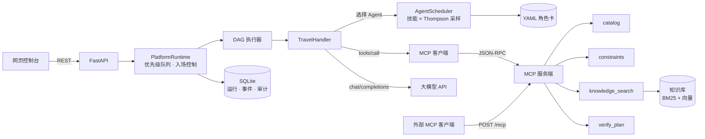

# A/FLOW · 多智能体编排调度平台

面向「大模型 Agent 工具编排调度平台」赛题的可运行原型。场景是**一日旅行规划**：多个规划 Agent 与审核 Agent 协作，在预算、营业时间、每周闭馆日、雨天户外景点上限、交通间隔、兴趣与必去景点等硬约束下，从 10 个景点中生成行程。平台对结果做程序化校验，不通过就带着失败原因自我循环重新规划，最后交给人工审批。

平台调用真实大模型（默认 DeepSeek，任何 OpenAI 兼容接口均可），API Key 在网页的「模型配置」页面填写。

## 赛题要求对照

| 赛题要求 | 实现 | 代码位置 |
|---|---|---|
| 知识库定义与集成 | 文档切块，BM25 与词形哈希向量做融合检索。网页可增删、检索。Agent 调模型前经 MCP 检索，命中片段写入 Prompt，Trace 中可见 | `packages/rag/`，`packages/rag/seed_docs/` |
| Agent 团队定义 | YAML 角色卡：职责、技能、工具权限、提示词、容量、温度、输出上限。版本化注册，调度时总是取最新版本 | `packages/agents/defs/*.yaml`，`packages/application/agents.py` |
| 工作流编排 | 工作流用 YAML 定义，由安全加载器校验必填字段、依赖、唯一性与无环后交给自研 DAG 执行器；支持并行、循环、子流程、条件人工关卡。页面上画出 DAG 图，运行时节点按状态实时着色。节点执行带 checkpoint，服务中断的运行可从断点继续，已成功的节点不再调用模型 | `packages/application/workflows/*.yaml`，`packages/core/engine/`，`apps/web/src/dag.js` |
| 动态调度 | 任务层：按关键路径、紧急度和等待老化计算优先级，入场控制限制并发。Agent 层：技能匹配 × Beta 后验 Thompson 采样，同时考虑成本、延迟与当前负载，满载的 Agent 不参与候选 | `packages/core/scheduler/`，`AgentScheduler` |
| 自我循环（Self-Loop） | 规划 → 校验子流程 → 失败原因反馈回下一轮 Prompt，受迭代上限、token 预算和调用次数上限约束 | `travel_workflow()`，`packages/application/handler.py` |
| 结果验证与反馈优化 | 三层验证：`verify_plan` 确定性核算，独立审核 Agent，人工最终审批。每次结果回写 Agent 历史表现，影响后续调度 | `verify_plan()`，`profiles.py` |
| MCP 与工具编排 | 自研 MCP 服务端，JSON-RPC 2.0，支持 `initialize`、`tools/list`、`tools/call`。Agent 通过原生 function calling **自主决定**调用哪些工具、调用几次：平台把该 Agent 白名单内的 MCP 工具发给模型，经 MCP 执行模型发起的调用，再把结果交回模型。模型服务不支持工具调用时自动降级为平台预取。另开放 `POST /mcp` 供外部客户端接入 | `packages/mcp/`，`packages/application/mcp_tools.py`，`handler.py` |

## 架构



工作流：

```
collect（并行：catalog ‖ constraints）
  → refine（循环，最多 3 轮）
      ├─ plan：选一个规划 Agent → 模型自主调用 catalog / constraints / knowledge_search / verify_plan → 给出计划
      └─ assurance 子流程：check（verify_plan）→ review（选一个审核 Agent，可自主调用 constraints / knowledge_search）
  → approval（human_review 为 true 时进入人工审批）
```

## 快速开始

需要 Python 3.11 及以上和 [uv](https://docs.astral.sh/uv/)（uv 会自动准备合适的 Python）。

```bash
uv sync                                   # 安装依赖
uv run python -m scripts.serve_platform   # 启动，只监听 127.0.0.1:8000
```

也可以用 Docker（不需要本机装 Python）：

```bash
docker compose up --build                 # 打开 http://127.0.0.1:8000
```

数据库和页面保存的 `.env` 都在 `./data` 目录，重建容器不会丢失。容器端口只映射到本机地址。

浏览器打开 http://127.0.0.1:8000 ：

1. **模型配置**：填写 API Key、接口地址和模型名。先点「测试连接」，它只请求 `/models`，不消耗 token；再点「保存配置」，配置写入本地 `.env`（已被 git 忽略），立即生效。
2. **任务与监控**：填写需求和约束，勾选费用确认后启动。右侧 Trace 每秒刷新，可以看到调度决策、MCP 工具调用、知识库命中、模型调用、校验结果和反馈。
3. **人工审批**：程序校验和独立审核都通过的任务会出现在这里，由人工决定通过或拒绝。
4. **Agent 团队 / 工作流 / 知识库**：查看角色卡和历史表现，查看工作流 DAG 图、YAML 原文和 MCP 工具列表，管理知识文档。
5. **从断点继续**：服务停止或重启时正在运行的任务会被标记为「可从断点继续」，在 Trace 里点按钮即可接着跑，已完成的节点从 checkpoint 恢复。用户主动取消的任务不能续跑。

每次启动会把 9 篇种子知识文档同步到最新版本（缺失的补上、内容有变化的更新、已下线的删除；你自己添加的文档不动）：景点指南、费用与交通规则、核算过的参考行程、常见错误的修正方法、雨天与高温安排、老人与孩子的出游节奏、必去景点的处理方法。也可以手动同步：

```bash
uv run python -m scripts.seed_db
```

### 演示建议

- **自我循环**：天气选「雨天」、预算 160 元。雨天最多 1 个户外景点，满足条件的组合只有 4 种（150 或 160 元），模型第一版容易超预算或排进第 2 个户外景点，Trace 里能看到「程序核验未通过 → 反馈 → 第 2 轮修正」，执行图上循环显示「第 2/3 轮」。
- **更紧的约束**：周一 + 雨天 + 预算 200 元。博物馆、科技馆周一闭馆，只剩「海洋馆 + 艺术馆 + 1 个户外景点」这类组合，且恰好 200 元。
- **停止条件**：星期选「周一」、必去景点勾选「城市博物馆」。博物馆周一闭馆，约束本身无解，所有轮次都会失败，演示到达迭代上限后安全停止。
- **断点续跑**：任务运行中停止服务（Ctrl+C）再启动，打开该任务点「从断点继续」。
- **动态调度**：连续提交几个优先级不同的任务。观察「优先级调度」事件里的派发顺序，以及「角色动态分配」事件里每个候选的效用分。
- **版本发现**：在「Agent 团队」页复制一个角色并递增版本号后注册，新任务会自动选用新版本。

### 场景与约束

景点目录共 10 个示例景点（5 个文化、5 个自然，观景塔两者都算），价格和时间为人工编写的测试数据。校验规则全部由 `verify_plan` 确定性执行：

| 约束 | 规则 |
|---|---|
| 预算 | 餐饮 40 元 + 门票 + 每段交通 10 元，不得超过预算 |
| 时间 | 相邻景点至少间隔 20 分钟；开始不早于日程开始与开门时间，结束不晚于日程结束与闭馆时间 |
| 闭馆日 | 博物馆、科技馆周一闭馆，艺术馆周二闭馆，海洋馆周三闭馆 |
| 天气 | 雨天最多安排 1 个户外景点（室内：博物馆、艺术馆、科技馆、海洋馆） |
| 覆盖 | 不同景点数不少于要求；覆盖全部兴趣类别；包含全部必去景点 |

`travel.solve` 用剪枝深度优先搜索给出“是否有解 / 最低费用”的基线，只用于评估，不参与 Agent 规划。

### Agent 如何自主调用工具

每个规划或审核步骤是一段与模型的多轮对话，最多往返 3 次：

1. 平台只把任务、上一轮计划和反馈发给模型，并附上该 Agent 有权使用的工具（由 MCP `tools/list` 生成 function 定义；`run_id` 等参数由平台注入，不暴露给模型）。
2. 模型返回 `tool_calls`，平台经 MCP 客户端逐个执行，白名单不符的调用会被拒绝，结果以 `tool` 消息交回。
3. 模型拿到数据后给出最终 JSON。最后一轮发送 `tool_choice: "none"`，强制模型作答。

Trace 里的「Agent 决定调用工具」事件记录每一轮模型选了哪些工具。不同角色的工具权限不同：预算规划师可以用 `verify_plan` 在提交前自检，审核员拿不到景点目录。

## 外部接入 MCP

平台的工具也能被外部 MCP 客户端调用，比如 MCP Inspector：选 Streamable HTTP，地址填 `http://127.0.0.1:8000/mcp`。

```bash
curl -s http://127.0.0.1:8000/mcp -H 'Content-Type: application/json' \
  -d '{"jsonrpc":"2.0","id":1,"method":"tools/list"}'

curl -s http://127.0.0.1:8000/mcp -H 'Content-Type: application/json' -d '{
  "jsonrpc":"2.0","id":2,"method":"tools/call",
  "params":{"name":"verify_plan","arguments":{
    "request":{"budget":200},
    "plan":{"stops":[{"spot_id":"park","start_minute":540},
                     {"spot_id":"museum","start_minute":650},
                     {"spot_id":"garden","start_minute":790}],
            "rationale":"省钱组合"}}}}'
```

## 测试

```bash
uv run pytest -q
```

测试用 `httpx.MockTransport` 替代模型服务，不联网，也不产生费用。覆盖范围：

- `test_travel_verify.py`：确定性校验（费用、营业时间、交通间隔、闭馆日、雨天户外上限、兴趣、必去景点、重复景点）与求解器基线
- `test_agents.py`：YAML 安全加载、版本发现、容量约束，以及历史表现对 Thompson 采样的影响
- `test_knowledge.py`：种子导入与同步（更新、下线）、检索相关性、去重与删除
- `test_mcp.py`：协议握手、工具发现、错误码、客户端白名单、动态工具不缓存
- `test_executor.py`：并行、循环直到通过、条件人工关卡、迭代上限、token 预算、取消
- `test_workflow.py`：YAML 工作流加载、轮数覆盖，加载器拒绝环、缺字段、依赖不存在、重复 id 与不安全 YAML
- `test_platform.py`：端到端流程，包括模型自主调用工具、工具白名单、最后一轮强制作答、不支持工具调用时降级、服务中断后从断点继续、用户取消不可续跑、默认知识库可检索、清空后自动补种、带反馈修正、达到上限、审核拒绝、模型报错不重试、并发调度
- `test_benchmark.py`：性能评估脚本的统计与有解 / 无解区分
- `test_api.py`：模型配置接口（不回显密钥、写 `.env`、测试连接）、`/mcp` 端点、跨站写入拦截

性能评估（结果写入 `reports/benchmark-*.md` 和 `.json`，可直接放进方案书）：

```bash
uv run python -m scripts.benchmark                    # mock 模式，免费，跑全部 17 个场景
uv run python -m scripts.benchmark --live --limit 5   # 真实模型，会产生费用
```

指标包括：有解场景的通过率与一次通过率、靠自我循环修正成功的次数、无解场景是否被正确拒绝、平均迭代轮数、调用次数、token、延迟与吞吐、方案费用与最优解的差距、模型自主调用各工具的次数。每个场景先用穷举求解器（`travel.solve`）算出是否有解和最低费用作为基线。mock 模式下的替身模型第一版随机、收到反馈后给出最优解，它衡量的是平台本身的行为与开销，不代表大模型的规划能力；模型效果以 `--live` 结果为准。

推送到 GitHub 后，`.github/workflows/ci.yml` 会在 Python 3.11 / 3.12 / 3.13 上跑 ruff、mypy、pytest 和 mock 性能评估，并构建 Docker 镜像做一次启动冒烟测试。

真实模型的单次验收（会产生费用）：

```bash
uv run python -m scripts.check_model --live      # 一次最多 64 token 的连通测试
uv run python -m scripts.check_workflow --live   # 跑一次完整工作流，Trace 保存到 reports/
```

## 目录结构

```
apps/api/            FastAPI 接口：运行、审批、Agent、知识库、模型配置、MCP 端点
apps/web/            原生 JS 控制台（含 DAG 渲染 dag.js），无构建步骤
packages/agents/     YAML 角色卡、安全加载器、Beta 历史表现
packages/application/ 运行时、领域处理器、旅游场景、YAML 工作流、MCP 工具、持久化
packages/core/       通用 DAG 执行器、工作流加载器、表达式、调度算法、数据模型
packages/llm/        OpenAI 兼容客户端、审计适配层
packages/mcp/        MCP 服务端与客户端
packages/rag/        知识库、检索器（BM25 / 向量 / 融合）、种子文档
packages/tools/      工具注册表：白名单、参数校验、幂等缓存
migrations/          Alembic 数据库迁移
scripts/             启动、种子导入、性能评估、真实模型验收、LLM 调用静态检查
tests/               自动化测试
Dockerfile           容器镜像；docker-compose.yml 一键启动
.github/workflows/   CI
```

## 安全与费用

- 服务只监听本机；非本机 Host 和跨站写入都会被拒绝。没有用户认证，请勿把端口暴露到公网。
- 每次启动任务都要勾选费用确认。每个 Agent 步骤最多与模型往返 3 次，单次运行最多调用 `6 × 迭代轮数` 次，每次输出不超过 1024 token，整次运行有 40000 token 预算。模型服务报错时不自动重发。
- 密钥只保存在本地 `.env`，网页和接口只显示首尾几位。

## 已知局限

- 景点目录是人工编写的 10 个示例景点，价格、营业时间和闭馆日不代表真实数据。
- 向量检索用的是离线词形哈希，不是语义 embedding，召回以字面匹配为主。
- 单进程单机原型。服务重启时，进行中的任务不会自动重新发起收费请求，需要在页面上手动「从断点继续」。
- `uv.lock` 记录的下载源是清华镜像；在国外下载慢时可删掉 `uv.lock` 后执行 `uv lock` 改用默认源。
